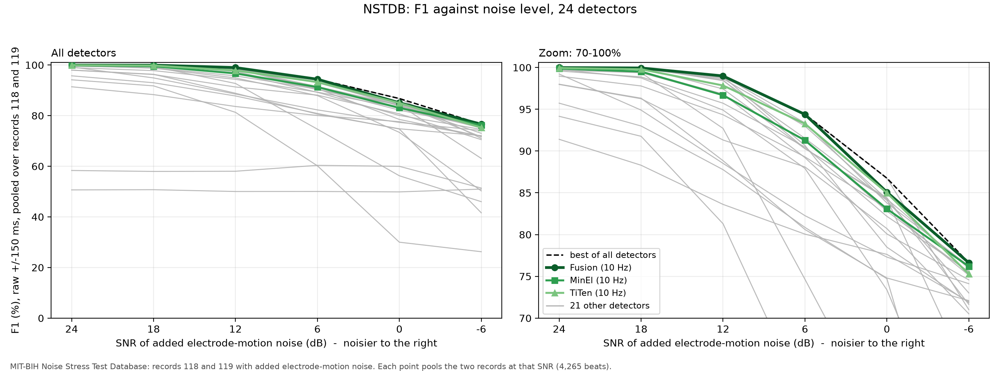

# tenhz-ecg - QRS detection from 10 samples per second

**Accurate ECG QRS detection from a 10 Hz min-max representation of the signal.**

Three single-lead QRS detectors (`MinEl`, `TiTen` and `Fusion`) that operate on 10 values per second, compiled with Numba.

- **Accuracy:** Evaluated on 482 recordings (2,663 h, ~12 M beats) from 8 PhysioNet databases (`MITDB`, `SVDB`, `EDB`, `NSRDB`, `QTDB`, `TWADB`, `NSTDB`, `LTAFDB`). `Fusion` scores significantly higher F1 than all 21 competing detectors, on both the test set and the held-out `LTAFDB`, which was not used for tuning. `MinEl` and `TiTen` rank directly below it and are not significantly worse than any competitor.
- **Speed:** `TiTen` is the fastest of the three; `MinEl` takes 1.6× and `Fusion` 1.8× its runtime. Against the next three most accurate detectors (by test F1), `TiTen` runs 37× faster than `hamilton2002`, 71× faster than WFDB `xqrs` and 72× faster than `emrich2023`, with a mean RR interval error below 5 ms on the test set.
- **Determinism:** Identical detections on a Linux Xeon server and an Apple laptop.

**Method:** The ECG is band-pass filtered at its native sampling rate, and each 200 ms block is reduced to its minimum and maximum, giving 10 values per second. Detection runs on this 10 Hz stream; each detected beat is reported at the native-rate sample of its extremum.

## Installation

```bash
python3 -m venv .venv             # create a virtual environment
source .venv/bin/activate         # activate it
pip install -e .                  # core library (numpy, scipy, numba)
pip install -r requirements.txt   # competing detectors and plotting (pinned versions)
```

## Quickstart

```python
import tenhz

# Optional: compile the Numba kernels before timing
tenhz.warmup()

# Detect R-peaks (detector: "minel", "titen" or "fusion")
res = tenhz.detect(ecg, fs=250, detector="fusion")
print(res.locations)  # 0-based sample indices (int64)
print(res.peaks)      # ECG amplitude at each detected peak

# Sample indices only
locs = tenhz.qrs_locations(ecg, fs=250, detector="titen")
```

### Input requirements and notes
- Single-lead 1-D array in mV, at least **10 seconds** long, finite values only (no `NaN`/`Inf`).
- Filtering is zero-phase (`filtfilt`), so processing is offline.
- The first call compiles the Numba kernels and caches them locally; later runs load them from the cache.
- **R-peak snap (2.1, default on):** each detection is moved to the R extremum of its QRS, with one QRS polarity per record decided on the first minute with a clear polarity (at most 10 min scanned, otherwise upright). `fusion` snaps both detectors with `MinEl`'s polarity. Pass `snap=False` for detections bit-identical to 2.0.
- `detector="fusion"` combines `MinEl` and `TiTen` on a shared 7–32 Hz stream using an RR-plausibility Viterbi decoder and an adaptive per-window switch. Its parameters were tuned on `MITDB` (excluding records `118` and `119`) and `SVDB` only.

## Results

Top 7 of 24 detectors (all are shown in Figure 1). Beats are matched within ±150 ms. Results are for version 2.1.0 (R-peak snap on, the default). Version 2.0 (`snap=False`) gave the same F1 for `Fusion`, `MinEl` and `TiTen` within 0.03.

- **Test set:** 274 recordings (`EDB`, `NSRDB`, `QTDB`, `TWADB`, `NSTDB`).
- **Held out:** `LTAFDB`, 84 recordings, 1,961 h.
- **RR error:** test set only.
- **Runtime:** relative to `TiTen`, measured on an Intel Xeon Platinum 8358 @ 2.60 GHz.
- **Significant:** the 95% paired bootstrap interval of the F1 difference excludes 0 and the Holm-corrected Wilcoxon p-value over records is below 0.05.

| Detector | Test F1 (%) | LTAFDB F1 (%) | RR error MAE / RMSE (ms) | Runtime (TiTen = 1×) |
| :--- | :---: | :---: | :---: | :---: |
| **Fusion (10 Hz)** | **99.60** | **99.01** | **4.2 / 8.9** | **1.8×** |
| **MinEl (10 Hz)** | **99.52** | **98.95** | **4.2 / 9.5** | **1.6×** |
| **TiTen (10 Hz)** | **99.48** | **98.71** | **4.1 / 8.9** | **1.0×** |
| hamilton2002 | 99.39 | 98.61 | 10.3 / 18.0 | 37× |
| WFDB `xqrs` | 99.37 | 97.77 | 4.5 / 10.1 | 71× |
| emrich2023 | 99.35 | 98.27 | 4.5 / 9.6 | 72× |
| WFDB `gqrs` | 99.04 | 97.37 | 4.7 / 9.9 | 203× |

**Figure 1:** all 24 detectors.
- **A:** F1 on each of the 8 databases and the pooled test set.
- **B:** RR interval error, MAE / RMSE.
- **C:** runtime relative to `TiTen`.

<p align="center">
  
</p>

**Figure 2:**
- **A:** test F1 against runtime.
- **B:** paired F1 difference between `Fusion` and each other detector, with 95% bootstrap confidence intervals, on the test set (274 recordings) and `LTAFDB` (84 recordings).

<p align="center">
  
</p>

**Figure 3:** F1 against noise level on `NSTDB` (records 118 and 119 with added electrode-motion noise, 24 to −6 dB SNR), all 24 detectors. The dashed line is the best F1 any detector reaches at each noise level. `Fusion` is within 1.5 F1 points of it at every level and matches it at −6 dB.

<p align="center">
  
</p>

### Notes on the competing detectors

All competing detectors run on the same single lead at its native sampling rate. NeuroKit2 methods use the NeuroKit2 cleaning method of the same name where one exists, and `neurokit` cleaning otherwise.

- **`ssf`:** NeuroKit2's default threshold finds no beats in ECG given in mV. The threshold is set to 600 (mV/s)², chosen on the training databases with `scripts/tune_ssf.py`.
- **NeuroKit2 errors:** the installed NeuroKit2 0.3.0 raises on some records for two methods, `manikandan2012` (41 records) and `emrich2023` (1 record, `LTAFDB` 113, which has a flat stretch of signal). Those records are re-run with patched copies of the two functions in `scripts/competitors.py`; every other record uses the installed code unchanged.

## Reproducing the benchmark

**Runtime:** The full benchmark takes about 35 hours of total compute, almost all of it in the slower competing detectors. Run it with several workers unless you need single-process timings.

```bash
# Download the PhysioNet databases into data/
python scripts/download_physionet.py --dbs mitdb svdb edb nsrdb qtdb twadb nstdb ltafdb

# Run all detectors on all 8 databases (10 parallel workers)
python scripts/benchmark_three.py --data data --dbs mitdb svdb edb nsrdb qtdb twadb nstdb ltafdb --methods all --out results/benchmark_v1 --workers 10

# Build the figures
python scripts/plot_figures.py --results results/benchmark_v1 --out figures/

# Build the NSTDB noise-level figure
python scripts/plot_nstdb_snr.py --results results/benchmark_v1 --out figures/

# Print the runtime table below
python scripts/runtime_table.py results/benchmark_v1
```

Use the pinned versions in `requirements.txt`. Other versions of the competing libraries, WFDB in particular, can change those detectors' results; `MinEl`, `TiTen` and `Fusion` are unaffected. `run_info.json` in the results folder records the library versions, CPU, worker count and wall-clock time of a run.

## Runtime

Intel Xeon Platinum 8358 @ 2.60 GHz, 30 vCPUs, 200 GB RAM. Times are detection only (reading files, saving detections and RR statistics are excluded), summed over all 482 recordings, run with 30 parallel workers.

| Detector | Total time | Share |
| :--- | :---: | :---: |
| `martinez2004` | 899.7 min (15.0 h) | 41.8% |
| `christov2004` | 272.2 min (4.5 h) | 12.6% |
| `zong2003` | 262.4 min (4.4 h) | 12.2% |
| `WFDB gqrs` | 145.5 min (2.4 h) | 6.8% |
| `engzeemod2012` | 119.4 min (2.0 h) | 5.5% |
| `khamis2016` | 108.1 min (1.8 h) | 5.0% |
| 15 other detectors combined | 342.3 min (5.7 h) | 15.9% |
| **Fusion (10 Hz)** | **1.7 min (101 s)** | **0.08%** |
| **MinEl (10 Hz)** | **1.4 min (82 s)** | **0.06%** |
| **TiTen (10 Hz)** | **0.9 min (51 s)** | **0.04%** |
| **All 24 detectors** | **2,153.5 min (35.9 h)** | **100%** |

Total wall-clock time for the full benchmark with 30 workers: **77 min**.

## Citation

If you use `tenhz` in your research, please cite:

```bibtex
@article{jayarathna2026tenhz,
  title   = {MinEl and TiTen: QRS Detection from a 10 Hz Min-Max Representation of the ECG},
  author  = {Jayarathna, Titus},
  year    = {2026}
}
```