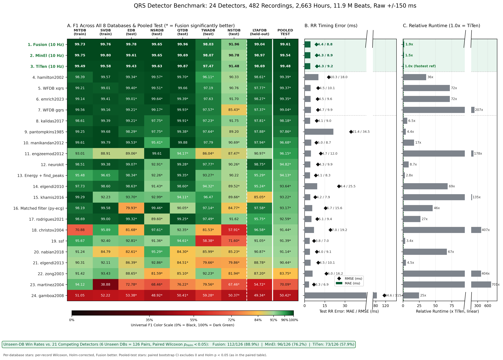

# tenhz-ecg - ECG QRS processing with only 10 samples per second.

**Rethinking how little data is needed for accurate ECG QRS detection.**

Fast, deterministic QRS detection from a **10 Hz min-max representation** of single-lead ECG (`MinEl`, `TiTen`, and `Fusion`), compiled with Numba.

- **State-of-the-art accuracy across 482 recordings (3,332 hours):** Tested on 8 PhysioNet databases (`MITDB`, `SVDB`, `EDB`, `NSRDB`, `QTDB`, `TWADB`, `NSTDB`, and held-out `LTAFDB`). The detectors outperform 20 competing QRS detectors, including on recordings not used during development or tuning.
- **10 Hz runtime efficiency:** `TiTen` is the fastest of the three detectors. `Fusion` takes 1.6× and `MinEl` 1.4× its runtime. Even so, `TiTen` is 26× faster than `hamilton2002` and 51× faster than WFDB `xqrs`, with RR interval MAE below 5 ms on the test set.
- **Deterministic processing:** ECG is bandpass-filtered at its native sampling rate before being converted into a 10 Hz block min-max representation.

## Installation

```bash
python3 -m venv .venv             # create virtual environment
source .venv/bin/activate         # activate 
pip install -e .                  # core library (numpy, scipy, numba)
pip install -r requirements.txt
```

## Quickstart

```python
import tenhz

# Optional: pre-compile Numba kernels before timing
tenhz.warmup()

# Detect R-peaks (options: "minel", "titen", "fusion")
res = tenhz.detect(ecg, fs=250, detector="fusion")
print(res.locations)  # 0-based sample indices (int64)
print(res.peaks)      # ECG amplitudes at detected peaks

# Sample indices only
locs = tenhz.qrs_locations(ecg, fs=250, detector="titen")
```

### Input Requirements & Notes
- Single-lead 1-D array (`mV`), minimum duration **10 seconds**, finite values only (no `NaN`/`Inf`).
- Offline zero-phase filtering (`filtfilt`). The first call compiles Numba kernels and caches them locally; subsequent runs load directly from cache.
- `detector="fusion"` combines `MinEl` and `TiTen` on a shared 7–32 Hz stream via an RR-plausibility Viterbi decoder and adaptive window switch, tuned strictly on `MITDB` (excluding records `118` and `119`) and `SVDB`.

## Benchmark Summary (Unseen Test Set, Raw ±150 ms AAMI Standard)

Top 7. All 23 in Figure 1. Test: 274 recordings (`EDB`, `NSRDB`, `QTDB`, `TWADB`, `NSTDB`). Held-out: 84 recordings (`LTAFDB`, 1,961 hours). RR is test set only. Runtime: `TiTen` = 1.0x (measured on an Intel Xeon Platinum 8358 CPU @ 2.60 GHz, 30 vCPUs).

| Detector | Pooled Test F1 (%) | LTAFDB Held-Out F1 (%) | Test RR MAE / RMSE (ms) | Relative Runtime (TiTen = 1.0x) |
| :--- | :---: | :---: | :---: | :---: |
| **Fusion (10 Hz)** | **99.61** | **99.04** | **4.4 / 8.8** | **1.6x** |
| **MinEl (10 Hz)** | **99.54** | **98.97** | **4.3 / 8.9** | **1.4x** |
| **TiTen (10 Hz)** | **99.48** | **98.69** | **4.3 / 9.2** | **1.0x** |
| hamilton2002 | 99.39 | 98.61 | 10.3 / 18.0 | 25.7x |
| WFDB `xqrs` | 99.37 | 97.77 | 4.5 / 10.1 | 50.5x |
| emrich2023 | 99.35 | 97.64 | 4.5 / 9.6 | 51.4x |
| WFDB `gqrs` | 99.04 | 97.37 | 4.7 / 9.9 | 145x |

Figure 1 — All 23 detectors, raw 150 ms. A: F1 across all 8 DBs plus pooled test. B: test RR timing error, MAE / RMSE in ms. C: relative runtime, 1.0x is TiTen.

<p align="center">
  
</p>

Figure 2 — Speed-accuracy trade-off and paired clean sweep, raw 150 ms. A: pooled test F1 vs relative runtime. B: paired per-record F1 gain, Fusion minus each comparator, with 95% bootstrap CI, on test (274 recs) and held-out LTAFDB (84 recs).

<p align="center">
  
</p>

## Reproducing the Benchmarks & Tests
**Runtime warning:** The full benchmark is computationally intensive. A modern multicore CPU should complete the experiment in several hours using parallel processing, whereas single-core execution may take several days. Use multicore processing for the full benchmark unless you specifically intend to measure single-core performance and runtime.

```bash

# Download and export PhysioNet databases to data/
python scripts/download_physionet.py --dbs mitdb svdb edb nsrdb qtdb twadb nstdb ltafdb

# Benchmark all 8 DBs (10-core processing)
python scripts/benchmark_three.py --data data --dbs mitdb svdb edb nsrdb qtdb twadb nstdb ltafdb --methods all --out results/benchmark_v1 --workers 10

# Build figures
python scripts/plot_figures.py --results results/benchmark_v1 --out figures/
```
## Runtime on Intel Xeon Platinum 8358 CPU @ 2.60 GHz, 30 vCPUs, 200 GB RAM
| Detector | Single-Core CPU Time | 30-Core Wall-Clock | Share of Total |
| :--- | :---: | :---: | :---: |
| `martinez2004` | 850.37 min (14.17 hr) | 28.35 min | 40.36% |
| `christov2004` | 275.14 min (4.59 hr) | 9.17 min | 13.06% |
| `zong2003` | 270.25 min (4.50 hr) | 9.01 min | 12.83% |
| `WFDB gqrs` | 145.98 min (2.43 hr) | 4.87 min | 6.93% |
| `engzeemod2012` | 118.45 min (1.97 hr) | 3.95 min | 5.62% |
| `khamis2016` | 105.32 min (1.76 hr) | 3.51 min | 5.00% |
| Other 15 baselines combined | 336.79 min (5.61 hr) | 11.23 min | 15.98% |
| **Fusion (10 Hz)** | **1.97 min (118.1 s)** | **3.94 s** | **0.09%** |
| **MinEl (10 Hz)** | **1.63 min (98.1 s)** | **3.27 s** | **0.08%** |
| **TiTen (10 Hz)** | **1.15 min (69.1 s)** | **2.30 s** | **0.05%** |
| **All 24 Detectors Total** | **2,107.06 min (35.12 hr)** | **70.24 min** | **100.00%** |

## Citation

If you use `tenhz` in your research, please cite:

```bibtex
@article{jayarathna2026tenhz,
  title   = {MinEl and TiTen: QRS Detection from a 10 Hz Min-Max Representation of the ECG},
  author  = {Jayarathna, Titus},
  year    = {2026}
}
```
