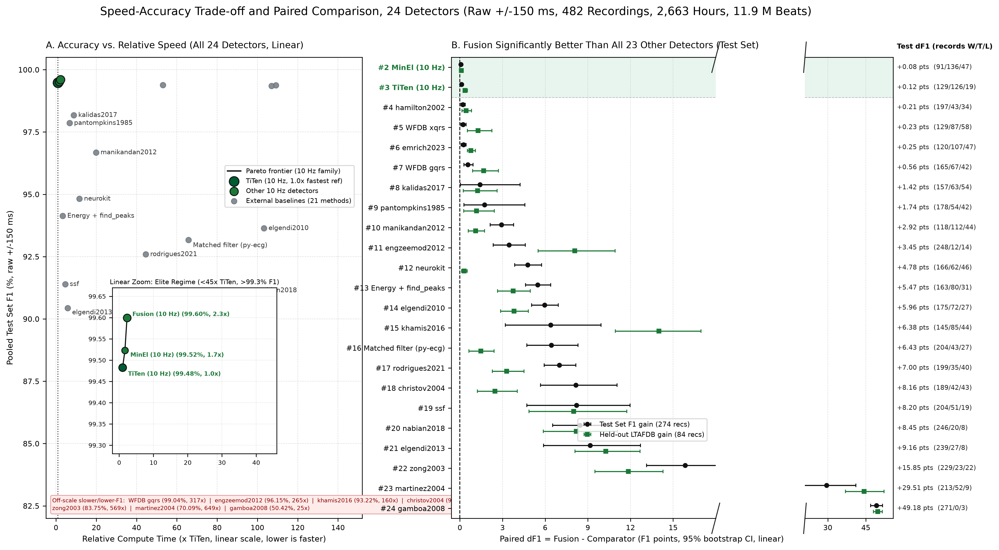

# tenhz-ecg - QRS detection from 10 samples per second

**Accurate ECG QRS detection from a 10 Hz min-max representation of the signal.**

Three single-lead QRS detectors (`MinEl`, `TiTen` and `Fusion`) that operate on 10 values per second, compiled with Numba.

- **Accuracy:** Evaluated on 482 recordings (2,663 h, ~12 M beats) from 8 PhysioNet databases (`MITDB`, `SVDB`, `EDB`, `NSRDB`, `QTDB`, `TWADB`, `NSTDB`, `LTAFDB`). `Fusion` scores significantly higher F1 than all 20 competing detectors, on both the test set and the held-out `LTAFDB`, which was not used for tuning. `MinEl` and `TiTen` rank directly below it and are not significantly worse than any competitor.
- **Speed:** `TiTen` is the fastest of the three; `MinEl` takes 1.4× and `Fusion` 1.6× its runtime. `TiTen` runs 26× faster than `hamilton2002` and 51× faster than WFDB `xqrs`, with a mean RR interval error below 5 ms on the test set.
- **Determinism:** Identical detections on a Linux Xeon server and an Apple laptop.

**Method:** The ECG is band-pass filtered at its native sampling rate, and each 200 ms block is reduced to its minimum and maximum, giving 10 values per second. Detection runs on this 10 Hz stream; each detected beat is reported at the native-rate sample of its extremum.

## Installation

```bash
python3 -m venv .venv             # create a virtual environment
source .venv/bin/activate         # activate it
pip install -e .                  # core library (numpy, scipy, numba)
pip install -r requirements.txt   # competing detectors and plotting (pinned versions)
```

## Quickstart

```python
import tenhz

# Optional: compile the Numba kernels before timing
tenhz.warmup()

# Detect R-peaks (detector: "minel", "titen" or "fusion")
res = tenhz.detect(ecg, fs=250, detector="fusion")
print(res.locations)  # 0-based sample indices (int64)
print(res.peaks)      # ECG amplitude at each detected peak

# Sample indices only
locs = tenhz.qrs_locations(ecg, fs=250, detector="titen")
```

### Input requirements and notes
- Single-lead 1-D array in mV, at least **10 seconds** long, finite values only (no `NaN`/`Inf`).
- Filtering is zero-phase (`filtfilt`), so processing is offline.
- The first call compiles the Numba kernels and caches them locally; later runs load them from the cache.
- `detector="fusion"` combines `MinEl` and `TiTen` on a shared 7–32 Hz stream using an RR-plausibility Viterbi decoder and an adaptive per-window switch. Its parameters were tuned on `MITDB` (excluding records `118` and `119`) and `SVDB` only.

## Results

Top 7 of 23 detectors (all are shown in Figure 1). Beats are matched within ±150 ms.

- **Test set:** 274 recordings (`EDB`, `NSRDB`, `QTDB`, `TWADB`, `NSTDB`).
- **Held out:** `LTAFDB`, 84 recordings, 1,961 h.
- **RR error:** test set only.
- **Runtime:** relative to `TiTen`, measured on an Intel Xeon Platinum 8358 @ 2.60 GHz.

| Detector | Test F1 (%) | LTAFDB F1 (%) | RR error MAE / RMSE (ms) | Runtime (TiTen = 1×) |
| :--- | :---: | :---: | :---: | :---: |
| **Fusion (10 Hz)** | **99.61** | **99.04** | **4.4 / 8.8** | **1.6×** |
| **MinEl (10 Hz)** | **99.54** | **98.97** | **4.3 / 8.9** | **1.4×** |
| **TiTen (10 Hz)** | **99.48** | **98.69** | **4.3 / 9.2** | **1.0×** |
| hamilton2002 | 99.39 | 98.61 | 10.3 / 18.0 | 25.7× |
| WFDB `xqrs` | 99.37 | 97.77 | 4.5 / 10.1 | 50.5× |
| emrich2023 | 99.35 | 97.64 | 4.5 / 9.6 | 51.4× |
| WFDB `gqrs` | 99.04 | 97.37 | 4.7 / 9.9 | 145× |

**Figure 1:** all 23 detectors.
- **A:** F1 on each of the 8 databases and the pooled test set.
- **B:** RR interval error, MAE / RMSE.
- **C:** runtime relative to `TiTen`.

<p align="center">
  
</p>

**Figure 2:**
- **A:** test F1 against runtime.
- **B:** paired F1 difference between `Fusion` and each other detector, with 95% bootstrap confidence intervals, on the test set (274 recordings) and `LTAFDB` (84 recordings).

<p align="center">
  
</p>

## Reproducing the benchmark

**Runtime:** The full benchmark takes about 35 hours of total compute, almost all of it in the slower competing detectors. Run it with several workers unless you need single-process timings.

```bash
# Download the PhysioNet databases into data/
python scripts/download_physionet.py --dbs mitdb svdb edb nsrdb qtdb twadb nstdb ltafdb

# Run all detectors on all 8 databases (10 parallel workers)
python scripts/benchmark_three.py --data data --dbs mitdb svdb edb nsrdb qtdb twadb nstdb ltafdb --methods all --exclude ssf --out results/benchmark_v1 --workers 10

# Build the figures
python scripts/plot_figures.py --results results/benchmark_v1 --out figures/
```

Use the pinned versions in `requirements.txt`. Other versions of the competing libraries, WFDB in particular, can change those detectors' results; `MinEl`, `TiTen` and `Fusion` are unaffected.

NeuroKit2's `ssf` method is excluded: with its default threshold it detects no beats in ECG given in mV.

## Runtime

Intel Xeon Platinum 8358 @ 2.60 GHz, 30 vCPUs, 200 GB RAM. Times are summed over all 482 recordings, run with 30 parallel workers.

| Detector | Total time | Share |
| :--- | :---: | :---: |
| `martinez2004` | 850.4 min (14.2 h) | 40.4% |
| `christov2004` | 275.1 min (4.6 h) | 13.1% |
| `zong2003` | 270.3 min (4.5 h) | 12.8% |
| WFDB `gqrs` | 146.0 min (2.4 h) | 6.9% |
| `engzeemod2012` | 118.5 min (2.0 h) | 5.6% |
| `khamis2016` | 105.3 min (1.8 h) | 5.0% |
| 14 other detectors combined | 334.7 min (5.6 h) | 15.9% |
| **Fusion (10 Hz)** | **2.0 min (118 s)** | **0.09%** |
| **MinEl (10 Hz)** | **1.6 min (98 s)** | **0.08%** |
| **TiTen (10 Hz)** | **1.2 min (69 s)** | **0.05%** |
| **All 23 detectors** | **2,105.0 min (35.1 h)** | **100%** |

Total wall-clock time for the full benchmark on this machine: **>70 min**.

## Citation

If you use `tenhz` in your research, please cite:

```bibtex
@article{jayarathna2026tenhz,
  title   = {MinEl and TiTen: QRS Detection from a 10 Hz Min-Max Representation of the ECG},
  author  = {Jayarathna, Titus},
  year    = {2026}
}
```
